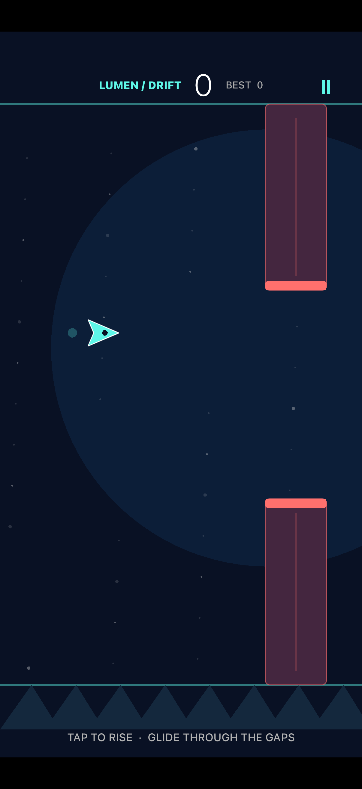

# Lumen Drift: playable, with an unresolved UI test discrepancy

The run delivered a native tap-to-fly game with independently observed gameplay
and passing core tests. Automated UI results disagreed across Mac stations,
however, and the cause remained unresolved. The useful distinction is between
the observed working game and the unreliable automation around it.

Run: `2026-11-05_ios-tap-to-fly` · 36 recorded messages · [Original mandate](mandate.md)

## What the product does

Lumen Drift is a portrait SpriteKit/UIKit game with original geometric art.
Taps lift the flyer through gates; collisions end the run. It includes a start
screen, score and best score, pause/resume, and restart. Restart clears the current
run and returns to ready while retaining the best score. It needs no external
assets, services, or third-party dependencies.

## How the run developed

1. **Implementation and independent QA split the work.** The engineer created a
   deterministic Swift core and native game, while the tester reviewed scoring,
   collision, and reset behavior. Mac station availability required coordination
   before the tester could perform independent simulator checks.
2. **The engineer got an early working build.** The initial core suite passed
   13 tests and the engineer's two UI tests passed. Manual inspection prompted a
   small HUD layout correction. The engineer then observed scoring, collision,
   and a nonzero-score restart and saved screenshots and logs.
3. **Independent automation contradicted that result.** The founder reproduced
   failures in both UI tests, including start and flight actions that did not
   produce the expected state. Disabling parallel testing did not resolve them.
   A timing race was suggested, but not established.
4. **The tester separated logic, automation, and manual behavior.** Independent
   QA passed 22 core checks, including nine additional edge cases. Its simulator
   build and launch succeeded. Pause/resume automation passed, but flight/restart
   automation failed eight assertions. Actual pointer interaction then visibly
   demonstrated upward flight, scoring, collision, and repeated restart.

## What worked, and what remains limited

The strongest evidence is the combination of independent core tests and observed
simulator interaction. Extra tests covered collision boundaries, suppressing score
on a fatal frame, once-only scoring, and repeated exact resets. Manual QA reached
a nonzero score and confirmed restart cleared the run while retaining the best.

The automated UI discrepancy remained open at delivery: two tests passed for the
engineer, while the founder and independent tester reproduced failures. It should
not be described as a proven timing issue or a fully passing UI suite. The tester's
Xcode process also hung while collecting diagnostics and was interrupted; its
incomplete result bundle was not valid evidence of successful completion.

The recorded environment was Xcode 27.0 with iPhone 17 / iOS 26.0. Neither
physical-device behavior nor broad OS, performance, or accessibility coverage
was established here.

## Try it or read the evidence

Extract [run_details.zip](run_details.zip), open
`output/shared/tap-to-fly/LumenDrift.xcodeproj` in Xcode, choose the LumenDrift
scheme and an installed iPhone simulator, and Run.

The archive includes transcripts, project, tests, captures, and
reports. In `messages.md`, mq records the founder's repeated UI failure and my
records final independent QA. See `output/shared/tap-to-fly/qa/REPORT.md` and
`output/shared/tap-to-fly/evidence/VALIDATION.md` for the detailed results.
The previously omitted, roughly 65 MB incomplete `IndependentUI.xcresult.tar.gz`
is still omitted; its raw log, screenshots, and failure report remain.

This summary describes the recorded run. During original packaging, the 13 core
tests were rerun successfully; simulator sessions were not replayed for this summary.

## Model and token usage

Token totals and resolved model identities are unavailable in the preserved
example archive. Its messages and product evidence do not establish those values;
no estimate is substituted for missing runtime usage records.
