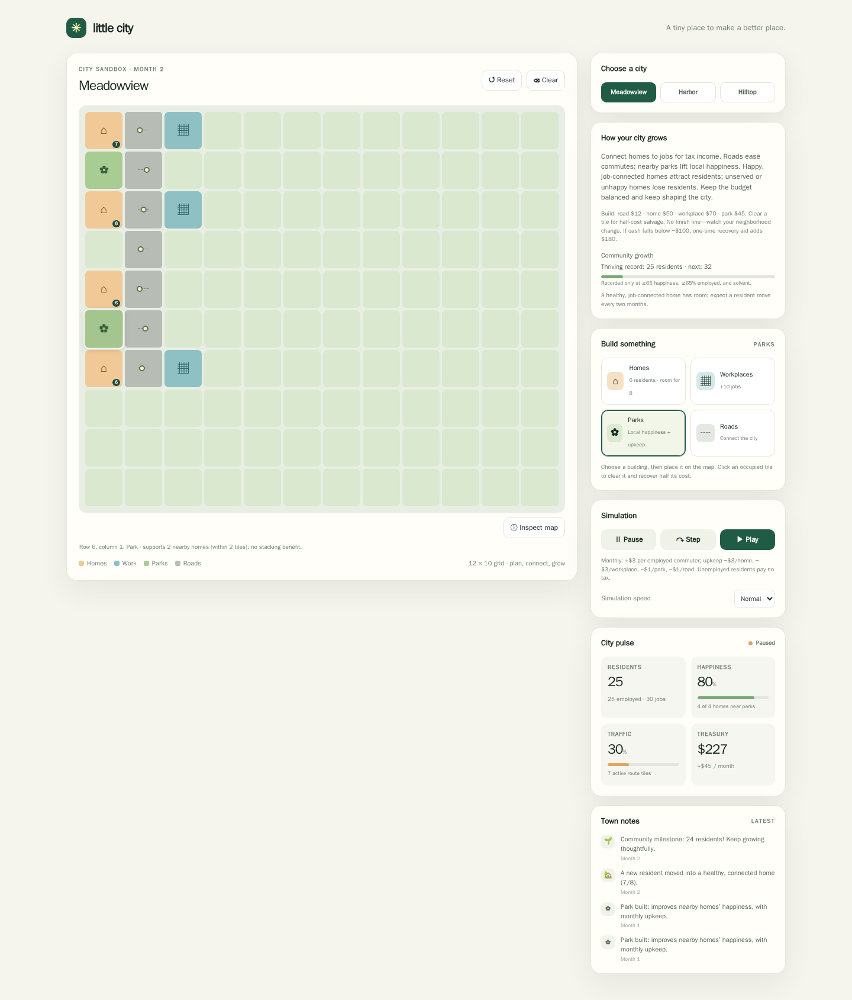

# Little City: from a working demo to a city sandbox

The run produced a self-contained browser city simulator, then evolved it through
two rounds of owner feedback. The strongest improvement was connecting roads,
jobs, housing, parks, and money into an ongoing simulation. The remaining weakness
is depth: it is a small sandbox that can settle into a plateau, not a campaign.

Run: `2026-11-05_miniature-city` · 97 recorded messages · [Original mandate](mandate.md)

## What the product does

Players place homes, workplaces, roads, and parks on a grid, or start from one of
three presets. Roads connect residents to finite job slots; employed residents
pay taxes; buildings cost money and require upkeep. Nearby parks help happiness,
while congestion and access to jobs affect the city's development. Step, Play,
speed controls, and a touch-friendly Inspect mode make the rules observable.
The final version starts paused and lets the player keep building indefinitely.

## How the run developed

1. **The first demo exposed simulation errors.** QA found that homes could be
   employed without roads to workplaces. Early repairs then double-counted
   residents across road components or lost jobs when a dead-end road was added.
   The implementation moved to a flow-based allocation of residents to jobs.
   Browser setup also took several attempts because downloads and dependencies
   were initially blocked; DOM checks preceded actual Chromium testing.
2. **Owner feedback shifted attention from correctness to play.** The working
   prototype looked attractive, but free construction, easy profit, and decorative
   commuting cues made decisions weak. The next version introduced construction
   costs, upkeep, employment taxes, and a 12-month employment challenge.
3. **Playing that revision revealed a better direction.** The owner could win
   Harbor with three road tiles and one step. Winning then stopped the simulation
   just as the city became useful. The next request invited a rethink of the loop,
   and the founder chose a continuing sandbox rather than tightening the target.
4. **QA refined the connected systems.** Testing exposed empty homes that could
   not recover, migration problems, cheap traffic-reduction tricks, and job
   allocation that stranded available capacity. Subsequent changes added recovery,
   fairer allocation, clearer growth guidance, and persistent inspection. The last
   patch kept inspection current and required a healthy, solvent city before
   awarding a population record.

## What worked, and what remains limited

The feedback cycles changed the product's purpose, not just its feature count.
QA also supplied concrete counterexamples that improved the simulation. A broad
independent regression on the penultimate substantive version covered presets,
reassignment, fair job allocation, recovery, traffic, parks, and controls; an
independent oracle checked 48 layouts, 192 runs, and 3,004 vacancy probes without
discrepancies. The exact final version received a narrower independent check of
inspection, reset, and record eligibility, which passed.

Those results establish specific behavior, not lasting enjoyment. The exploratory
120-second play session used an earlier revision and still found weak milestone
motivation and awkward navigation. Commuting remains an aggregate model with
animated cues rather than individual journeys. The final sandbox can plateau,
and testing used Chromium with emulated mobile input, not physical phones or a
broad browser matrix.

## Try it or read the evidence

Extract [run_details.zip](run_details.zip), then open
`output/shared/city/index.html` in a browser. No server is needed.

The archive includes the complete transcripts, source, tests, screenshots, and
reports. In `messages.md`, start with m1e for the first product critique, m1v for
the sandbox rethink, and m2m–m2p for delivery and final QA. The report index is
`output/org/founder/playtest/work/round3-playtest.md`.

This summary describes the recorded run; the app was not replayed for this summary.

## Model and token usage

Token totals and resolved model identities are unavailable in the preserved
example archive. Its messages and product evidence do not establish those values;
no estimate is substituted for missing runtime usage records.
