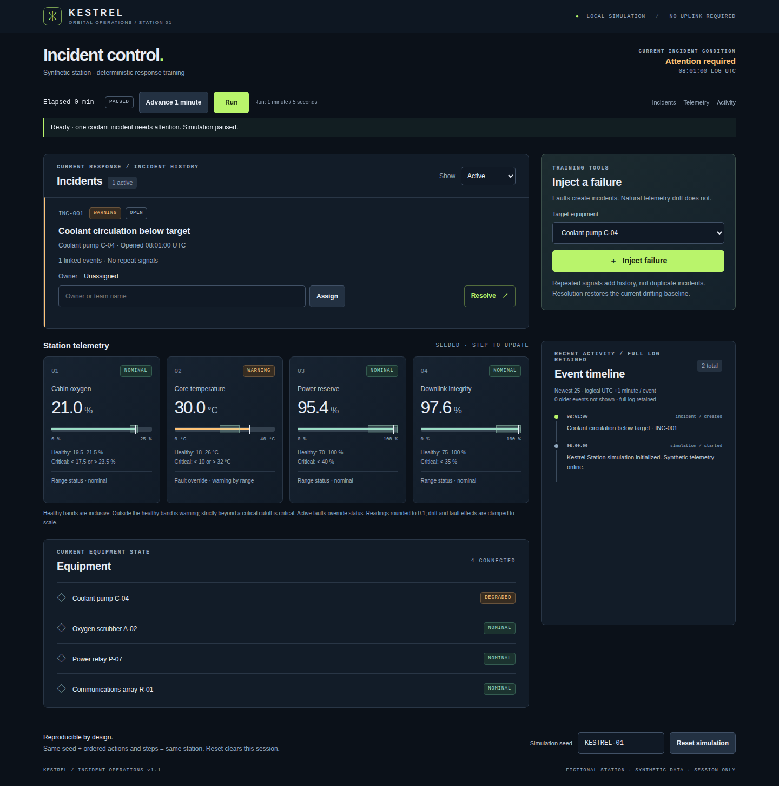

# Kestrel: making an incident dashboard useful to operate

The run delivered an offline space-station dashboard with a well-tested incident
lifecycle. Owner feedback then made it less static and easier to operate: time
controls, clearer gauges, and a more prominent incident queue turned a polished
first version into a more useful simulation.

Run: `2026-11-05_space-station` · 52 recorded messages · [Original mandate](mandate.md)

## What the product does

Kestrel generates seeded sensor readings and equipment failures for one fictional
station. An operator injects failures, assigns incident owners, resolves incidents,
and follows repeated events in a timeline. The final version adds deterministic
minute stepping and a paused-by-default Run/Pause control, plus gauge ranges,
thresholds, status text, and clearer current-versus-recent activity.

## How the run developed

1. **The team agreed on behavior before implementation.** The founder,
   implementation specialist, and independent tester coordinated an interface
   covering incident creation, ownership, resolution, repeated failures, and
   deterministic replay. QA prepared tests while implementation proceeded.
2. **The initial delivery passed its core checks.** Independent testing reported
   15 domain tests and seven offline Chromium browser groups passing. One usability
   issue remained: rejecting a blank owner could place the feedback below the
   visible viewport.
3. **Owner use identified the next improvements.** Reviewing the app in Safari,
   the owner found the incident actions worked well but the simulation felt static.
   Large telemetry cards pushed response work down the page, and gauges lacked
   clear operational meaning. The request kept the scope to one station.
4. **The refinement made time and priorities explicit.** The team clarified clock,
   reset, and threshold behavior before changing code. It moved incident actions
   ahead of telemetry, preserved drafts and focus during ticks, put validation
   beside the input, and clarified repeat counts and recent history.
5. **QA caught a visual regression.** Healthy gauge bands had the wrong CSS color.
   Implementation fixed it, and independent QA repeated the relevant checks
   before final delivery.

## What worked, and what remains limited

This was a productive feedback cycle: the first version provided working behavior
to evaluate, and the owner observations led to focused improvements. Explicit
interface agreement helped implementation and QA preserve existing behavior while
adding the time controls.

Final independent results were 28 domain tests, nine offline Chromium browser
groups, and a separate real-clock check passing. QA verified the gauge fix and
visible validation at desktop and narrow viewport sizes. No confirmed functional
defects remained within that tested scope.

The simulation is deliberately limited. State lasts only for the session;
natural telemetry drift does not create incidents by itself. Run advances one
simulated minute per five-second callback. Long sessions, full accessibility, and
other browsers were not independently certified. The owner's Safari review is
useful product feedback, but is not a substitute for a Safari regression suite.
The optional two-station extension was never requested or implemented.

## Try it or read the evidence

Extract [run_details.zip](run_details.zip), then open
`output/shared/station/index.html` locally. No server or dependencies are needed.

The archive contains transcripts, app source, tests, screenshots, and reports.
In `messages.md`, mk records the owner feedback and m1g the final delivery.
`output/shared/station/QA-REFINEMENT-REPORT.md` records final verification;
`QA-REPORT.md` in that directory describes the earlier version.

This summary describes the recorded run. During original packaging, the 28 Node
tests were rerun successfully; browser sessions were not replayed for this summary.

## Model and token usage

Token totals and resolved model identities are unavailable in the preserved
example archive. Its messages and product evidence do not establish those values;
no estimate is substituted for missing runtime usage records.
